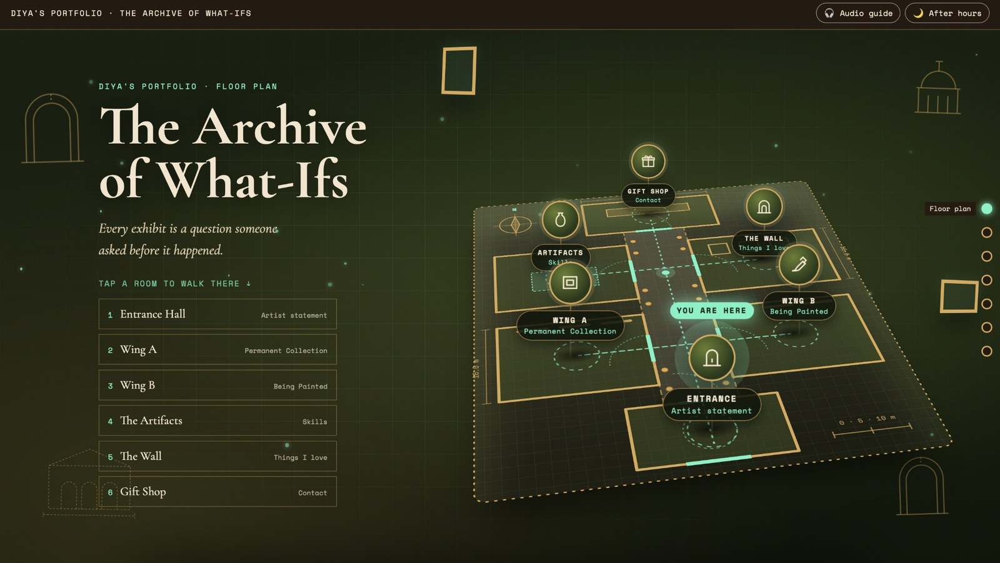
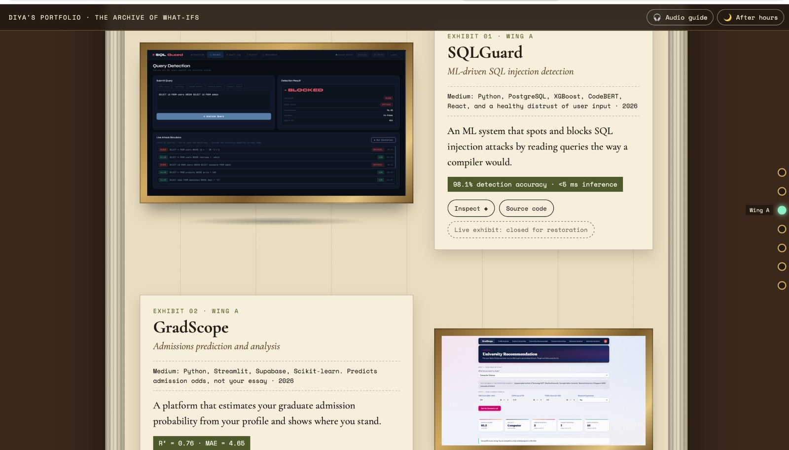
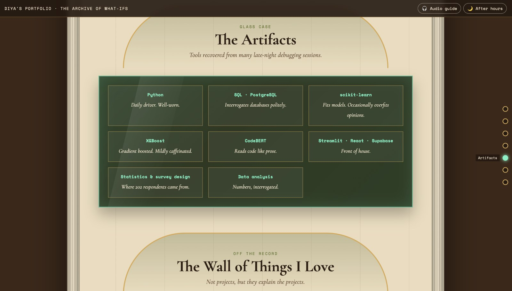
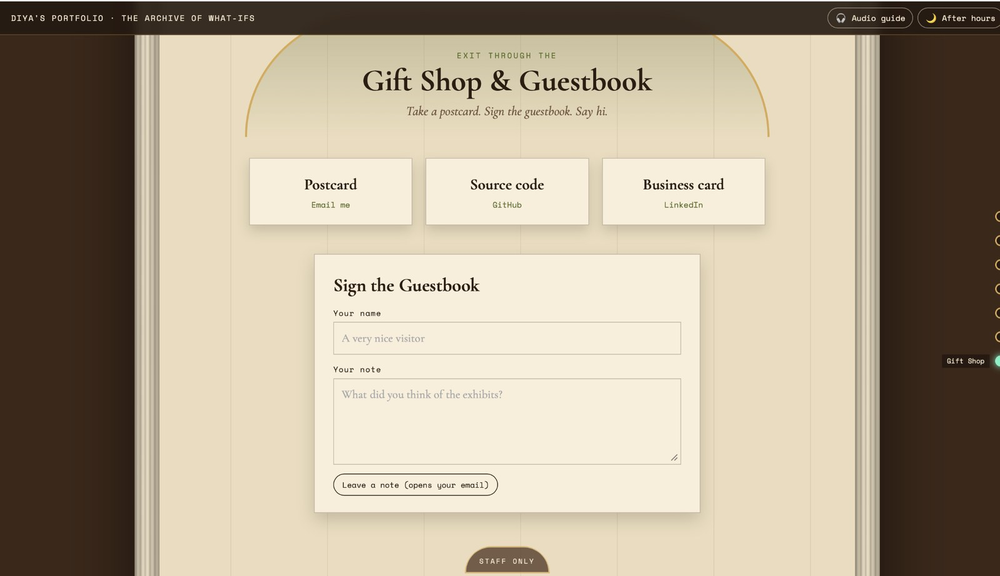

<div align="center">

# The Archive of What-Ifs

**A personal portfolio designed as an interactive museum.**

A collection of projects, skills, and curiosities — presented as exhibits in a digital archive.

[**Explore the live portfolio →**](https://portfolio-diyamehta.vercel.app)

</div>

---

## Overview

The Archive of What-Ifs reimagines a conventional portfolio as a museum you can explore. Visitors begin at an interactive floor plan, move through themed rooms, and discover projects and skills as curated exhibits.

Built from scratch with **HTML, CSS, and vanilla JavaScript**, without a front-end framework or website builder.

## Preview

### The floor plan

An interactive museum map acts as the entrance to the experience.



### Project exhibits

Projects are presented as framed exhibits with descriptions, technologies, and links where available.



### The artifacts

A museum-style skills display and a personal wall add character beyond the project list.



### The guestbook

The final room brings together contact links and a guestbook-style note form.



## Highlights

- **Interactive floor plan** for navigating between rooms
- **Curated project exhibits** for selected technical work
- **Skills display** presented as a museum glass case
- **The Wall of Things I Love** for interests beyond code
- **Audio guide** and an “After hours” visual mode
- **Guestbook-style contact section**

## Built with

- HTML5
- CSS3
- Vanilla JavaScript

## Run locally

No build step or package installation is required.

1. Clone or download this repository.
2. Open `index.html` in your browser.

For a more reliable local preview, serve the folder with any simple static HTTP server.

## Project structure

```text
.
├── index.html
├── style.css
├── script.js
├── map.css
├── map.js
├── assets/
└── readme-assets/
```

## Live demo

**[portfolio-diyamehta.vercel.app](https://portfolio-diyamehta.vercel.app)**

---

<div align="center">

*Built with curiosity, care, and a little museum magic.*

</div>
